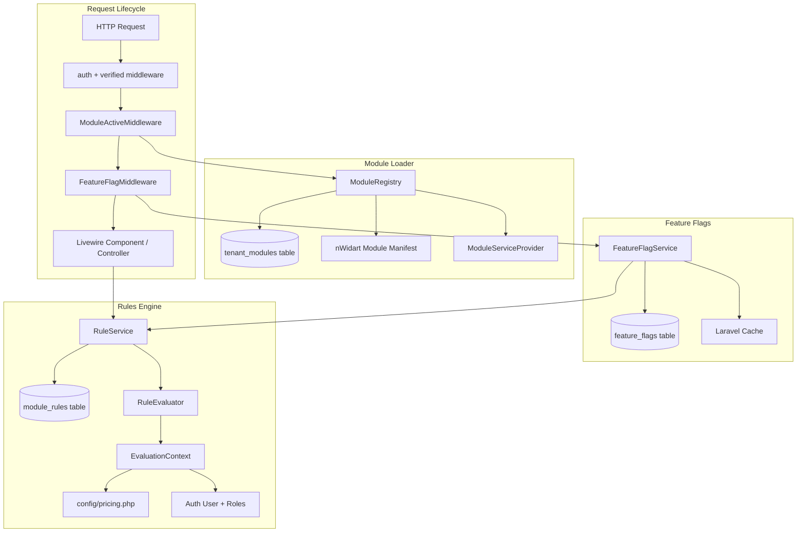
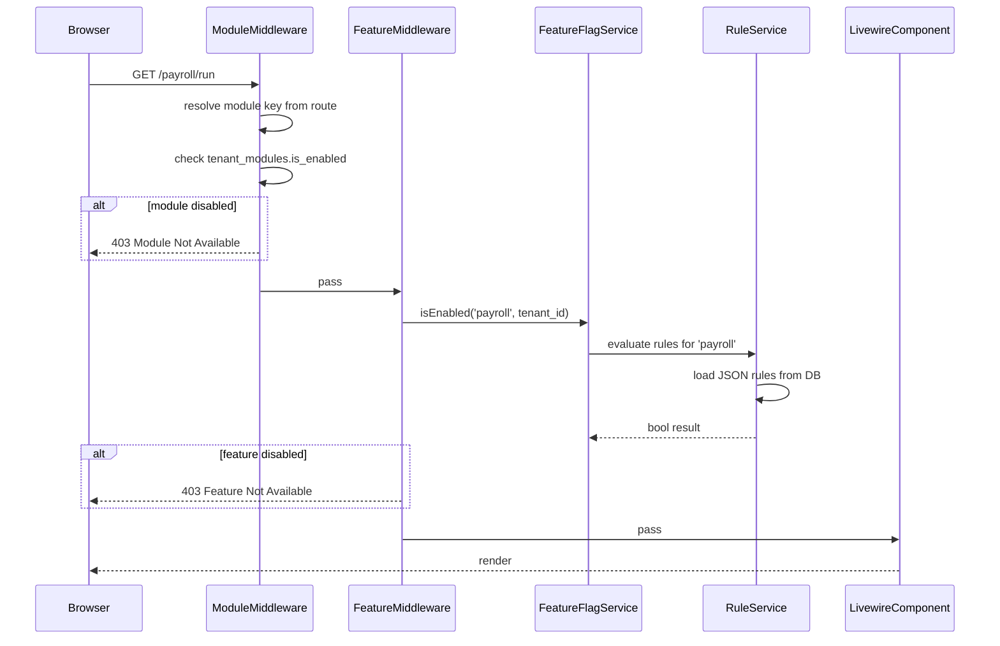

# Design Document: Module Loader System, Feature Flags & Rules Engine

## Overview

This feature introduces three tightly integrated subsystems to the uMsizi HR Management Portal: a **Module Loader** that dynamically registers and enables/disables Laravel modules per tenant using nWidart/laravel-modules; a **Feature Flags** layer that gates access to individual features within those modules via a database-driven flag table and middleware; and a **Rules Engine** that evaluates JSON-encoded business rules stored in the database to determine module/feature availability, pricing plan entitlements, and custom tenant overrides.

The system is designed for a single-tenant present state but with a `tenant_id` column on all relevant tables so multi-tenancy can be introduced later without schema changes. The existing `config/pricing.php` plan definitions serve as the canonical source of truth for which modules belong to which plan, and the Rules Engine can override or extend those defaults at runtime.

The three subsystems form a layered stack: the Module Loader sits at the bottom (is this module installed and registered?), Feature Flags sit in the middle (is this feature enabled for this tenant?), and the Rules Engine sits at the top (does this tenant's plan/rules allow access right now?).

---

## Architecture



### Request Flow



---

## Components and Interfaces

### 3.1 Module Loader

**Purpose**: Tracks which nWidart modules are installed and whether each is enabled for a given tenant. Provides a service to query and toggle module state.

**Interface**:
```php
interface ModuleRegistryInterface
{
    /** Returns true if the module is installed AND enabled for the tenant. */
    public function isActive(string $moduleKey, ?int $tenantId = null): bool;

    /** Enable a module for a tenant. */
    public function enable(string $moduleKey, int $tenantId): void;

    /** Disable a module for a tenant. */
    public function disable(string $moduleKey, int $tenantId): void;

    /** Return all modules with their enabled state for a tenant. */
    public function allForTenant(int $tenantId): Collection;
}
```

**Responsibilities**:
- Reads `tenant_modules` table to determine per-tenant enabled state
- Falls back to `config/pricing.php` plan modules when no explicit DB row exists
- Provides a cached lookup (TTL 60 s) to avoid per-request DB hits
- Exposes an Artisan command `modules:sync` to seed `tenant_modules` from the pricing config

---

### 3.2 Feature Flag Service

**Purpose**: Provides a fine-grained on/off switch for individual features within a module, independent of the module's overall enabled state.

**Interface**:
```php
interface FeatureFlagServiceInterface
{
    /** Check if a feature flag is enabled for a tenant. */
    public function isEnabled(string $flag, ?int $tenantId = null): bool;

    /** Enable a flag for a tenant. */
    public function enable(string $flag, int $tenantId): void;

    /** Disable a flag for a tenant. */
    public function disable(string $flag, int $tenantId): void;

    /** Bulk-set flags from an array ['flag_key' => bool]. */
    public function sync(array $flags, int $tenantId): void;
}
```

**Responsibilities**:
- Reads `feature_flags` table; falls back to `true` when no row exists (opt-out model)
- Delegates to `RuleService` when a flag has associated rules
- Caches results per `{tenant_id}:{flag}` key (TTL 30 s)
- Fires `FeatureFlagChanged` event on toggle for cache invalidation

---

### 3.3 Rule Service

**Purpose**: Loads JSON rule definitions from `module_rules` and evaluates them against a runtime context (tenant plan, user roles, date, employee count, etc.).

**Interface**:
```php
interface RuleServiceInterface
{
    /**
     * Evaluate all rules for a module/feature key.
     * Returns true if ALL rules pass (AND semantics by default).
     */
    public function evaluate(string $subject, array $context = []): bool;

    /** Store or update a rule definition. */
    public function upsert(string $subject, string $ruleKey, array $ruleDefinition): void;

    /** Remove a rule. */
    public function remove(string $subject, string $ruleKey): void;
}
```

**Responsibilities**:
- Loads rules from `module_rules` table, cached per subject (TTL 120 s)
- Supports operators: `equals`, `not_equals`, `in`, `not_in`, `gte`, `lte`, `gt`, `lt`, `contains`, `not_contains`
- Supports logical combinators: `and` (default), `or`, `not`
- Builds `EvaluationContext` from `Auth::user()`, tenant record, and `config/pricing.php`
- Returns `true` when no rules exist for a subject (permissive default)

---

## Data Models

### tenant_modules

```php
Schema::create('tenant_modules', function (Blueprint $table) {
    $table->id();
    $table->unsignedBigInteger('tenant_id')->default(1)->index();
    $table->string('module_key');          // e.g. 'payroll'
    $table->boolean('is_enabled')->default(true);
    $table->json('metadata')->nullable();  // reserved for future use
    $table->timestamps();
    $table->unique(['tenant_id', 'module_key']);
});
```

**Validation Rules**:
- `module_key` must be one of the keys defined in `config('pricing.modules')`
- `tenant_id` + `module_key` is unique (one row per tenant per module)

---

### feature_flags

```php
Schema::create('feature_flags', function (Blueprint $table) {
    $table->id();
    $table->unsignedBigInteger('tenant_id')->default(1)->index();
    $table->string('flag_key');            // e.g. 'payroll.bulk_run'
    $table->boolean('is_enabled')->default(true);
    $table->text('description')->nullable();
    $table->timestamps();
    $table->unique(['tenant_id', 'flag_key']);
});
```

**Validation Rules**:
- `flag_key` follows dot-notation: `{module}.{feature}` (e.g. `leave_management.approval_workflow`)
- `is_enabled` defaults to `true` (opt-out model — unknown flags are considered enabled)

---

### module_rules

```php
Schema::create('module_rules', function (Blueprint $table) {
    $table->id();
    $table->unsignedBigInteger('tenant_id')->default(1)->index();
    $table->string('subject');             // module key or flag key
    $table->string('rule_key')->unique();  // human-readable identifier
    $table->json('definition');            // rule JSON (see schema below)
    $table->boolean('is_active')->default(true);
    $table->integer('priority')->default(0); // higher = evaluated first
    $table->timestamps();
    $table->index(['tenant_id', 'subject']);
});
```

**Rule Definition JSON Schema**:
```json
{
  "combinator": "and",
  "conditions": [
    {
      "field": "plan",
      "operator": "in",
      "value": ["professional", "enterprise"]
    },
    {
      "field": "employee_count",
      "operator": "lte",
      "value": 100
    }
  ]
}
```

**Supported `field` values in EvaluationContext**:
- `plan` — tenant's current pricing plan key
- `employee_count` — number of active employees
- `user_role` — authenticated user's primary role name
- `module_key` — the subject module key
- `date` — current date (ISO 8601)
- `day_of_week` — 0 (Sunday) – 6 (Saturday)

---

## Algorithmic Pseudocode

### Module Active Check

```pascal
ALGORITHM isModuleActive(moduleKey, tenantId)
INPUT: moduleKey: String, tenantId: Integer
OUTPUT: isActive: Boolean

PRECONDITION: moduleKey ∈ config('pricing.modules').keys()
POSTCONDITION: result reflects DB state OR pricing plan default

BEGIN
  cacheKey ← "module_active:{tenantId}:{moduleKey}"
  
  IF cache.has(cacheKey) THEN
    RETURN cache.get(cacheKey)
  END IF
  
  row ← tenant_modules.where('tenant_id', tenantId)
                       .where('module_key', moduleKey)
                       .first()
  
  IF row IS NOT NULL THEN
    result ← row.is_enabled
  ELSE
    // Fall back to pricing plan default
    tenant ← getTenant(tenantId)
    planModules ← config("pricing.plans.{tenant.plan}.modules")
    result ← moduleKey ∈ planModules
  END IF
  
  cache.put(cacheKey, result, ttl=60)
  RETURN result
END
```

**Loop Invariants**: N/A (no loops)

---

### Feature Flag Evaluation

```pascal
ALGORITHM isFeatureEnabled(flagKey, tenantId)
INPUT: flagKey: String, tenantId: Integer
OUTPUT: enabled: Boolean

PRECONDITION: flagKey is non-empty string
POSTCONDITION: result is true when no row exists (opt-out model)

BEGIN
  cacheKey ← "feature_flag:{tenantId}:{flagKey}"
  
  IF cache.has(cacheKey) THEN
    RETURN cache.get(cacheKey)
  END IF
  
  flag ← feature_flags.where('tenant_id', tenantId)
                       .where('flag_key', flagKey)
                       .first()
  
  IF flag IS NULL THEN
    result ← true   // opt-out: unknown flags are enabled
  ELSE
    result ← flag.is_enabled
  END IF
  
  // If enabled at DB level, also run rules
  IF result = true THEN
    result ← ruleService.evaluate(flagKey, buildContext(tenantId))
  END IF
  
  cache.put(cacheKey, result, ttl=30)
  RETURN result
END
```

---

### Rule Evaluation Engine

```pascal
ALGORITHM evaluateRules(subject, context)
INPUT: subject: String, context: Map<String, Any>
OUTPUT: passed: Boolean

PRECONDITION: context contains at minimum {plan, employee_count, user_role}
POSTCONDITION: true when no active rules exist for subject

BEGIN
  rules ← module_rules.where('subject', subject)
                       .where('is_active', true)
                       .orderBy('priority', 'desc')
                       .get()
  
  IF rules IS EMPTY THEN
    RETURN true
  END IF
  
  // Evaluate each rule; ALL must pass (AND across rules)
  FOR each rule IN rules DO
    ASSERT rule.definition is valid JSON
    passed ← evaluateDefinition(rule.definition, context)
    IF NOT passed THEN
      RETURN false
    END IF
  END FOR
  
  RETURN true
END

ALGORITHM evaluateDefinition(definition, context)
INPUT: definition: Object {combinator, conditions[]}, context: Map
OUTPUT: result: Boolean

BEGIN
  combinator ← definition.combinator ?? "and"
  results ← []
  
  FOR each condition IN definition.conditions DO
    fieldValue ← context[condition.field]
    condResult ← applyOperator(condition.operator, fieldValue, condition.value)
    results.append(condResult)
  END FOR
  
  IF combinator = "and" THEN
    RETURN ALL(results)
  ELSE IF combinator = "or" THEN
    RETURN ANY(results)
  ELSE IF combinator = "not" THEN
    RETURN NOT ALL(results)
  END IF
END

ALGORITHM applyOperator(operator, fieldValue, ruleValue)
INPUT: operator: String, fieldValue: Any, ruleValue: Any
OUTPUT: Boolean

BEGIN
  MATCH operator WITH
    "equals"       → RETURN fieldValue = ruleValue
    "not_equals"   → RETURN fieldValue ≠ ruleValue
    "in"           → RETURN fieldValue ∈ ruleValue
    "not_in"       → RETURN fieldValue ∉ ruleValue
    "gte"          → RETURN fieldValue ≥ ruleValue
    "lte"          → RETURN fieldValue ≤ ruleValue
    "gt"           → RETURN fieldValue > ruleValue
    "lt"           → RETURN fieldValue < ruleValue
    "contains"     → RETURN ruleValue ∈ fieldValue
    "not_contains" → RETURN ruleValue ∉ fieldValue
    DEFAULT        → THROW UnknownOperatorException(operator)
  END MATCH
END
```

**Loop Invariants**:
- `evaluateRules`: All previously evaluated rules passed when the loop continues
- `evaluateDefinition`: `results` array grows by exactly one boolean per iteration

---

## Key Functions with Formal Specifications

### ModuleRegistry::isActive()

```php
public function isActive(string $moduleKey, ?int $tenantId = null): bool
```

**Preconditions**:
- `$moduleKey` is a non-empty string present in `config('pricing.modules')`
- `$tenantId` is a positive integer or null (null resolves to tenant ID 1 for single-tenant)

**Postconditions**:
- Returns `true` iff the module is both installed (nWidart manifest) AND enabled in `tenant_modules` (or plan default)
- Result is cached for 60 seconds; cache is invalidated on `enable()`/`disable()` calls
- No side effects on the database

---

### FeatureFlagService::isEnabled()

```php
public function isEnabled(string $flag, ?int $tenantId = null): bool
```

**Preconditions**:
- `$flag` is non-empty and follows `module.feature` dot-notation
- The parent module must be active (caller's responsibility to check first)

**Postconditions**:
- Returns `true` when no `feature_flags` row exists (opt-out model)
- Returns `false` when `is_enabled = false` in DB, regardless of rules
- When `is_enabled = true`, delegates to `RuleService::evaluate()` and returns its result
- Result is cached for 30 seconds per `{tenantId}:{flag}` key

---

### RuleService::evaluate()

```php
public function evaluate(string $subject, array $context = []): bool
```

**Preconditions**:
- `$subject` is a non-empty string (module key or flag key)
- `$context` may be empty; missing fields default to `null` during operator evaluation

**Postconditions**:
- Returns `true` when no active rules exist for `$subject`
- Returns `false` if ANY active rule's definition evaluates to `false`
- Throws `InvalidRuleDefinitionException` if a rule's JSON is malformed
- No writes to the database

---

## Example Usage

### Checking module access in a Livewire component

```php
// In a Livewire component mount() or render()
use App\Services\ModuleRegistry;
use App\Services\FeatureFlagService;

public function mount(ModuleRegistry $modules, FeatureFlagService $flags): void
{
    if (! $modules->isActive('payroll')) {
        $this->redirect(route('dashboard'));
        return;
    }

    $this->canBulkRun = $flags->isEnabled('payroll.bulk_run');
}
```

### Defining a rule that restricts payroll to Professional+ plans

```php
use App\Services\RuleService;

$ruleService->upsert('payroll', 'plan_gate', [
    'combinator' => 'and',
    'conditions' => [
        ['field' => 'plan', 'operator' => 'in', 'value' => ['professional', 'enterprise']],
    ],
]);
```

### Middleware protecting a route group

```php
// routes/web.php
Route::prefix('payroll')->name('payroll.')->middleware(['module:payroll', 'feature:payroll'])->group(function () {
    Route::get('run', RunPayroll::class)->name('run');
    Route::get('history', PayrollHistory::class)->name('history');
});
```

### Artisan sync command

```bash
php artisan modules:sync          # seeds tenant_modules from pricing config
php artisan modules:sync --tenant=1 --plan=professional
```

---

## Correctness Properties

*A property is a characteristic or behavior that should hold true across all valid executions of a system — essentially, a formal statement about what the system should do. Properties serve as the bridge between human-readable specifications and machine-verifiable correctness guarantees.*

### Property 1: Module gate is a superset of feature gate

*For any* module key `M` and tenant, if `ModuleRegistry::isActive(M)` returns `false`, then `FeatureFlagService::isEnabled(F)` MUST also return `false` for every flag key `F` whose prefix matches `M` (enforced by middleware ordering).

**Validates: Requirements 11.1, 11.2**

---

### Property 2: Opt-out flag semantics

*For any* flag key `F` with no row in `feature_flags` for a given tenant, `FeatureFlagService::isEnabled(F)` returns `true`.

**Validates: Requirements 3.1**

---

### Property 3: Rule permissiveness

*For any* subject `S` with no active rows in `module_rules`, `RuleService::evaluate(S)` returns `true`.

**Validates: Requirements 5.1**

---

### Property 4: Pricing plan fallback consistency

*For any* module `M` listed in `config('pricing.plans.{plan}.modules')`, a tenant on that plan with no explicit `tenant_modules` row will have `ModuleRegistry::isActive(M)` return `true`.

**Validates: Requirements 1.2, 1.3**

---

### Property 5: Cache coherence after toggle

*For any* module key or flag key, after calling `enable()` or `disable()` on the corresponding service, the next call to `isActive()` or `isEnabled()` reflects the updated state (cache is invalidated before the method returns).

**Validates: Requirements 2.3, 4.3**

---

### Property 6: Operator determinism

*For any* valid operator and any pair of `(fieldValue, ruleValue)`, `applyOperator(operator, fieldValue, ruleValue)` is deterministic — identical inputs always produce identical outputs.

**Validates: Requirements 7.1–7.10**

---

### Property 7: Unknown operator throws

*For any* operator string that is not one of the 10 defined operators, `applyOperator` throws `InvalidRuleDefinitionException` rather than silently returning `false`.

**Validates: Requirements 7.11**

---

### Property 8: AND combinator semantics

*For any* rule definition with `combinator = "and"` and N conditions, `RuleEvaluator::evaluateDefinition()` returns `false` if and only if at least one condition evaluates to `false`.

**Validates: Requirements 6.1, 6.4**

---

### Property 9: OR combinator semantics

*For any* rule definition with `combinator = "or"` and N conditions, `RuleEvaluator::evaluateDefinition()` returns `true` if and only if at least one condition evaluates to `true`.

**Validates: Requirements 6.2**

---

### Property 10: NOT combinator semantics

*For any* rule definition with `combinator = "not"` and N conditions, `RuleEvaluator::evaluateDefinition()` returns the logical negation of what `combinator = "and"` would return for the same conditions.

**Validates: Requirements 6.3**

---

### Property 11: Multi-rule AND semantics

*For any* subject with multiple active rules, `RuleService::evaluate()` returns `false` if and only if at least one rule's definition evaluates to `false`.

**Validates: Requirements 5.2**

---

### Property 12: modules:sync idempotence

*For any* tenant and pricing plan configuration, running `modules:sync` twice produces the same `tenant_modules` state as running it once.

**Validates: Requirements 2.4**

---

## Error Handling

### Module Not Found

**Condition**: `moduleKey` passed to `ModuleRegistry` is not in `config('pricing.modules')`
**Response**: Throw `InvalidModuleKeyException` with the invalid key in the message
**Recovery**: Caller catches and logs; middleware returns 404

### Malformed Rule JSON

**Condition**: `module_rules.definition` column contains invalid JSON or missing required keys (`combinator`, `conditions`)
**Response**: `RuleService` throws `InvalidRuleDefinitionException`; the rule is skipped and logged as an error
**Recovery**: System falls back to `true` (permissive) for that rule to avoid locking out tenants due to bad data

### Cache Backend Unavailable

**Condition**: Redis/file cache throws during `cache.get()` or `cache.put()`
**Response**: Services catch `\Exception` and fall through to a direct DB query
**Recovery**: Graceful degradation — slightly higher DB load but no outage

### Middleware Module Disabled

**Condition**: `ModuleActiveMiddleware` detects `isActive()` returns `false`
**Response**: Returns HTTP 403 with a Blade view `errors.module-disabled` showing the plan upgrade prompt
**Recovery**: User is directed to the pricing page

---

## Testing Strategy

### Unit Testing Approach

- `RuleService` operator logic tested with PHPUnit data providers covering all 10 operators and edge values (null, empty string, zero)
- `FeatureFlagService` opt-out default tested: assert `isEnabled('nonexistent.flag')` returns `true`
- `ModuleRegistry` plan fallback tested: assert module in plan config returns `true` when no DB row exists

### Property-Based Testing Approach

**Property Test Library**: PestPHP with `pest-plugin-faker` or raw PHPUnit data providers (no external PBT library required for this scope)

Key properties to verify:
- For any valid `operator` and matching `fieldValue`/`ruleValue` pair, `applyOperator` is deterministic (same inputs → same output)
- `evaluateDefinition` with `combinator=and` and N conditions returns `false` iff at least one condition is `false`
- `evaluateDefinition` with `combinator=or` and N conditions returns `true` iff at least one condition is `true`

### Integration Testing Approach

- Feature test: HTTP GET to a module-protected route with module disabled → assert 403
- Feature test: HTTP GET to a module-protected route with module enabled → assert 200
- Feature test: `RuleService::evaluate('payroll', ['plan' => 'free'])` with a `plan in [professional, enterprise]` rule → assert `false`
- Feature test: `ModuleRegistry::enable()` then `isActive()` → assert cache is fresh and returns `true`

---

## Performance Considerations

- All three services use Laravel's cache layer (default: file driver for SQLite dev, Redis for production)
- TTLs are intentionally short (30–120 s) to balance freshness vs. DB load
- `module_rules` table has a composite index on `(tenant_id, subject)` to keep rule lookups O(log n)
- `tenant_modules` and `feature_flags` have unique composite indexes that double as fast lookup indexes
- The `modules:sync` Artisan command is idempotent (`upsert`) and safe to run in deployment scripts

---

## Security Considerations

- Module/feature toggle endpoints (admin UI, future) MUST be protected by `permission:manage-modules` (Spatie)
- Rule definitions are stored as JSON and evaluated server-side only — no `eval()` or dynamic PHP execution
- `EvaluationContext` is built from server-side data only (Auth user, DB tenant record) — never from user-supplied request input
- Middleware runs before Livewire component hydration, preventing unauthorized component state access
- Cache keys are namespaced by `tenant_id` to prevent cross-tenant data leakage when multi-tenancy is introduced

---

## Dependencies

| Dependency | Purpose | Already Installed |
|---|---|---|
| `nwidart/laravel-modules` | Module manifest, autoloading, Artisan commands | No — requires `composer require` |
| `spatie/laravel-permission` | RBAC for admin toggle permissions | Yes |
| `livewire/livewire` | Reactive UI components | Yes |
| Laravel Cache (file/Redis) | Service-level caching | Yes (built-in) |
| `config/pricing.php` | Plan → module mapping source of truth | Yes |
