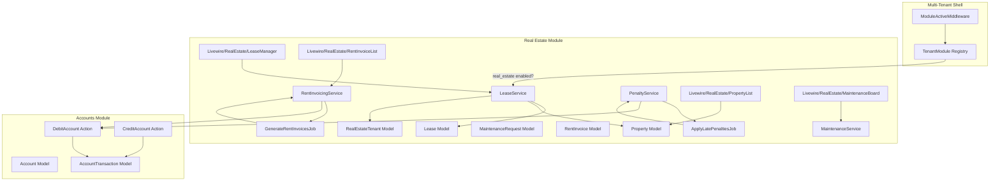
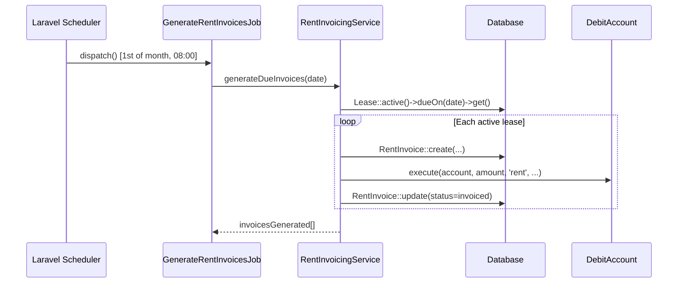
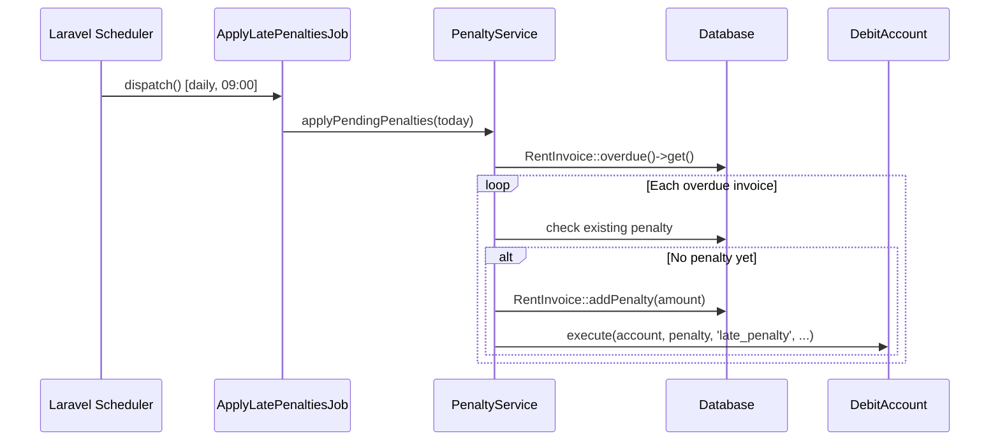
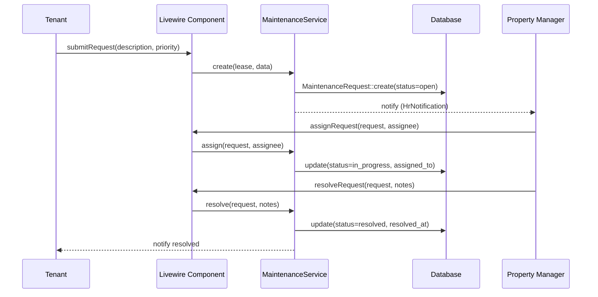

# Design Document: Real Estate Module

## Overview

The Real Estate Module extends the existing Laravel multi-tenant HR/ERP system to manage commercial and residential properties, lease agreements, tenant relationships, automated rent invoicing, late-payment penalties, and maintenance requests. It follows the same architectural conventions already established in the codebase: Eloquent models with typed casts, Action classes for business operations, Livewire components for UI, Spatie permissions for RBAC, and the `TenantModule` registry for per-tenant feature gating.

The module is registered under the module key `real_estate` and is guarded by the existing `ModuleActiveMiddleware`. All financial operations (rent invoicing, penalty charges) integrate with the existing `accounts` / `account_transactions` ledger via the `CreditAccount` / `DebitAccount` action pattern.

---

## Architecture



---

## Sequence Diagrams

### Automated Rent Invoicing (Scheduler)



### Late Payment Penalty



### Maintenance Request Workflow



---

## Data Models

### Property

```php
// Table: re_properties
Schema::create('re_properties', function (Blueprint $table) {
    $table->id();
    $table->string('reference')->unique();          // PROP-2026-00001
    $table->foreignId('tenant_id')->constrained('users')->cascadeOnDelete(); // owning company/tenant
    $table->string('name');
    $table->string('type');                         // residential, commercial, industrial
    $table->text('address');
    $table->string('city');
    $table->string('country')->default('ZA');
    $table->integer('units')->default(1);           // number of lettable units
    $table->decimal('market_value', 15, 2)->nullable();
    $table->enum('status', ['available', 'partially_let', 'fully_let', 'under_maintenance', 'inactive'])->default('available');
    $table->text('description')->nullable();
    $table->foreignId('created_by')->constrained('users')->cascadeOnDelete();
    $table->timestamps();
    $table->softDeletes();

    $table->index(['tenant_id', 'status']);
});
```

**Relationships:**
- `hasMany(Lease::class)`
- `hasMany(MaintenanceRequest::class)`
- `belongsTo(User::class, 'created_by')`

---

### RealEstateTenant (extends Customer concept)

```php
// Table: re_tenants
// Represents the person/company renting a property unit.
// Linked to a User account when the tenant has portal access.
Schema::create('re_tenants', function (Blueprint $table) {
    $table->id();
    $table->string('reference')->unique();          // TEN-2026-00001
    $table->foreignId('company_tenant_id')->constrained('users')->cascadeOnDelete(); // owning company
    $table->foreignId('user_id')->nullable()->constrained('users')->nullOnDelete();  // portal user link
    $table->string('name');
    $table->string('email')->nullable();
    $table->string('phone')->nullable();
    $table->string('id_number')->nullable();        // national ID / company reg
    $table->enum('type', ['individual', 'company'])->default('individual');
    $table->text('address')->nullable();
    $table->enum('status', ['active', 'inactive', 'blacklisted'])->default('active');
    $table->text('notes')->nullable();
    $table->foreignId('created_by')->constrained('users')->cascadeOnDelete();
    $table->timestamps();
    $table->softDeletes();

    $table->index(['company_tenant_id', 'status']);
});
```

**Relationships:**
- `hasMany(Lease::class)`
- `belongsTo(User::class, 'user_id')`

---

### Lease

```php
// Table: re_leases
Schema::create('re_leases', function (Blueprint $table) {
    $table->id();
    $table->string('reference')->unique();          // LSE-2026-00001
    $table->foreignId('property_id')->constrained('re_properties')->cascadeOnDelete();
    $table->foreignId('re_tenant_id')->constrained('re_tenants')->cascadeOnDelete();
    $table->foreignId('account_id')->nullable()->constrained('accounts')->nullOnDelete(); // rent credited here
    $table->date('start_date');
    $table->date('end_date');
    $table->decimal('monthly_rent', 15, 2);
    $table->decimal('deposit_amount', 15, 2)->default(0);
    $table->boolean('deposit_paid')->default(false);
    $table->integer('payment_due_day')->default(1);  // day of month rent is due (1-28)
    $table->decimal('penalty_rate', 5, 2)->default(5.00); // % of overdue amount per month
    $table->integer('grace_period_days')->default(5);     // days before penalty kicks in
    $table->enum('status', ['draft', 'active', 'expired', 'terminated', 'renewed'])->default('draft');
    $table->date('terminated_at')->nullable();
    $table->text('termination_reason')->nullable();
    $table->foreignId('created_by')->constrained('users')->cascadeOnDelete();
    $table->timestamps();
    $table->softDeletes();

    $table->index(['property_id', 'status']);
    $table->index(['re_tenant_id', 'status']);
    $table->index(['status', 'end_date']);
});
```

**Relationships:**
- `belongsTo(Property::class)`
- `belongsTo(RealEstateTenant::class, 're_tenant_id')`
- `belongsTo(Account::class)`
- `hasMany(RentInvoice::class)`
- `hasMany(MaintenanceRequest::class)`

---

### RentInvoice

```php
// Table: re_rent_invoices
Schema::create('re_rent_invoices', function (Blueprint $table) {
    $table->id();
    $table->string('reference')->unique();          // RNT-2026-00001
    $table->foreignId('lease_id')->constrained('re_leases')->cascadeOnDelete();
    $table->date('billing_period');                 // first day of the billed month
    $table->date('due_date');
    $table->decimal('rent_amount', 15, 2);
    $table->decimal('penalty_amount', 15, 2)->default(0);
    $table->decimal('total_amount', 15, 2);         // rent + penalty
    $table->enum('status', ['pending', 'invoiced', 'paid', 'overdue', 'cancelled'])->default('pending');
    $table->date('paid_at')->nullable();
    $table->foreignId('transaction_id')->nullable()->constrained('account_transactions')->nullOnDelete();
    $table->foreignId('created_by')->nullable()->constrained('users')->nullOnDelete();
    $table->timestamps();

    $table->index(['lease_id', 'status']);
    $table->index(['status', 'due_date']);
    $table->unique(['lease_id', 'billing_period']); // one invoice per lease per month
});
```

---

### MaintenanceRequest

```php
// Table: re_maintenance_requests
Schema::create('re_maintenance_requests', function (Blueprint $table) {
    $table->id();
    $table->string('reference')->unique();          // MNT-2026-00001
    $table->foreignId('property_id')->constrained('re_properties')->cascadeOnDelete();
    $table->foreignId('lease_id')->nullable()->constrained('re_leases')->nullOnDelete();
    $table->foreignId('re_tenant_id')->nullable()->constrained('re_tenants')->nullOnDelete();
    $table->string('title');
    $table->text('description');
    $table->enum('category', ['plumbing', 'electrical', 'structural', 'appliance', 'security', 'other'])->default('other');
    $table->enum('priority', ['low', 'medium', 'high', 'urgent'])->default('medium');
    $table->enum('status', ['open', 'in_progress', 'pending_parts', 'resolved', 'closed', 'cancelled'])->default('open');
    $table->foreignId('assigned_to')->nullable()->constrained('users')->nullOnDelete();
    $table->timestamp('assigned_at')->nullable();
    $table->timestamp('resolved_at')->nullable();
    $table->text('resolution_notes')->nullable();
    $table->decimal('repair_cost', 10, 2)->nullable();
    $table->foreignId('created_by')->constrained('users')->cascadeOnDelete();
    $table->timestamps();

    $table->index(['property_id', 'status']);
    $table->index(['status', 'priority']);
});
```

---

## Service Classes

### LeaseService

**Responsibility:** Lease lifecycle — create, activate, renew, terminate.

```php
namespace App\Services\RealEstate;

class LeaseService
{
    /**
     * Create a new lease in draft status.
     * Preconditions: property is available, tenant is active, dates are valid.
     * Postconditions: Lease created with status=draft, reference generated.
     */
    public function create(array $data, User $actor): Lease;

    /**
     * Activate a draft lease.
     * Preconditions: lease status=draft, deposit_paid=true (if required).
     * Postconditions: lease status=active, property status updated.
     */
    public function activate(Lease $lease, User $actor): Lease;

    /**
     * Renew an active or expiring lease with a new end date and optional rent adjustment.
     * Postconditions: old lease status=renewed, new Lease created with status=active.
     */
    public function renew(Lease $lease, array $renewalData, User $actor): Lease;

    /**
     * Terminate a lease early.
     * Postconditions: lease status=terminated, terminated_at set, property status updated.
     */
    public function terminate(Lease $lease, string $reason, User $actor): Lease;

    /**
     * Query leases expiring within $days days for renewal reminders.
     */
    public function getExpiringSoon(int $days = 30): Collection;
}
```

---

### RentInvoicingService

**Responsibility:** Generate monthly rent invoices and record ledger entries.

```php
namespace App\Services\RealEstate;

class RentInvoicingService
{
    public function __construct(
        private DebitAccount $debitAccount,
        private CreditAccount $creditAccount,
    ) {}

    /**
     * Generate invoices for all active leases due on $billingDate.
     * Called by GenerateRentInvoicesJob.
     *
     * Preconditions:
     *   - $billingDate is a valid Carbon date
     *   - Active leases exist with payment_due_day matching $billingDate->day
     *
     * Postconditions:
     *   - One RentInvoice per lease created (idempotent via unique constraint)
     *   - AccountTransaction recorded for each invoice
     *   - Invoice status set to 'invoiced'
     *
     * Loop invariant: each iteration processes exactly one lease; no duplicate invoices.
     */
    public function generateDueInvoices(Carbon $billingDate): Collection;

    /**
     * Mark an invoice as paid and record the credit transaction.
     * Preconditions: invoice status is 'invoiced' or 'overdue'.
     * Postconditions: invoice status=paid, paid_at set, credit transaction recorded.
     */
    public function markPaid(RentInvoice $invoice, User $actor): RentInvoice;

    /**
     * Return all overdue invoices (due_date < today, status != paid|cancelled).
     */
    public function getOverdueInvoices(): Collection;
}
```

---

### PenaltyService

**Responsibility:** Calculate and apply late payment penalties to overdue invoices.

```php
namespace App\Services\RealEstate;

class PenaltyService
{
    public function __construct(
        private DebitAccount $debitAccount,
    ) {}

    /**
     * Apply penalties to all overdue invoices past their grace period.
     * Called by ApplyLatePenaltiesJob daily.
     *
     * Preconditions:
     *   - $asOf is today's date
     *   - Overdue invoices exist with due_date + grace_period_days < $asOf
     *
     * Postconditions:
     *   - penalty_amount updated on invoice (additive, not replaced)
     *   - total_amount = rent_amount + penalty_amount
     *   - AccountTransaction recorded per penalty application
     *   - Invoice status set to 'overdue'
     *
     * Loop invariant: penalty applied at most once per invoice per day.
     */
    public function applyPendingPenalties(Carbon $asOf): void;

    /**
     * Calculate the penalty amount for a given invoice on $asOf.
     * Formula: penalty = rent_amount * (penalty_rate / 100) * months_overdue
     */
    public function calculatePenalty(RentInvoice $invoice, Carbon $asOf): float;
}
```

---

### MaintenanceService

**Responsibility:** Maintenance request lifecycle — create, assign, resolve, close.

```php
namespace App\Services\RealEstate;

class MaintenanceService
{
    /**
     * Create a new maintenance request.
     * Postconditions: request created with status=open, property manager notified.
     */
    public function create(array $data, User $actor): MaintenanceRequest;

    /**
     * Assign a request to a maintenance worker.
     * Postconditions: status=in_progress, assigned_to set, assigned_at set.
     */
    public function assign(MaintenanceRequest $request, User $assignee, User $actor): MaintenanceRequest;

    /**
     * Mark a request as resolved with resolution notes.
     * Postconditions: status=resolved, resolved_at set, tenant notified.
     */
    public function resolve(MaintenanceRequest $request, string $notes, ?float $cost, User $actor): MaintenanceRequest;

    /**
     * Close a resolved request after tenant confirmation.
     * Postconditions: status=closed.
     */
    public function close(MaintenanceRequest $request, User $actor): MaintenanceRequest;
}
```

---

## Scheduled Jobs

### GenerateRentInvoicesJob

```php
namespace App\Jobs\RealEstate;

class GenerateRentInvoicesJob implements ShouldQueue
{
    use Dispatchable, InteractsWithQueue, Queueable, SerializesModels;

    public function __construct(private Carbon $billingDate) {}

    public function handle(RentInvoicingService $service): void
    {
        // Runs on the 1st of each month at 08:00
        // Generates invoices for all active leases due today
        $service->generateDueInvoices($this->billingDate);
    }
}
```

### ApplyLatePenaltiesJob

```php
namespace App\Jobs\RealEstate;

class ApplyLatePenaltiesJob implements ShouldQueue
{
    use Dispatchable, InteractsWithQueue, Queueable, SerializesModels;

    public function handle(PenaltyService $service): void
    {
        // Runs daily at 09:00
        // Applies penalties to all overdue invoices past grace period
        $service->applyPendingPenalties(Carbon::today());
    }
}
```

### Scheduler Registration (routes/console.php)

```php
use App\Jobs\RealEstate\GenerateRentInvoicesJob;
use App\Jobs\RealEstate\ApplyLatePenaltiesJob;
use Illuminate\Support\Facades\Schedule;

// Generate rent invoices on the 1st of every month at 08:00
Schedule::job(new GenerateRentInvoicesJob(Carbon::today()))
    ->monthlyOn(1, '08:00')
    ->withoutOverlapping()
    ->onOneServer();

// Apply late payment penalties daily at 09:00
Schedule::job(new ApplyLatePenaltiesJob())
    ->dailyAt('09:00')
    ->withoutOverlapping()
    ->onOneServer();
```

---

## Algorithmic Pseudocode

### generateDueInvoices

```pascal
PROCEDURE generateDueInvoices(billingDate)
  INPUT: billingDate (Carbon date)
  OUTPUT: collection of created RentInvoice records

  SEQUENCE
    leases ← Lease
      .where('status', 'active')
      .where('payment_due_day', billingDate.day)
      .where('start_date', '<=', billingDate)
      .where('end_date', '>=', billingDate)
      .with(['property', 'reTenant', 'account'])
      .get()

    created ← []

    FOR each lease IN leases DO
      // Idempotency guard — skip if invoice already exists for this period
      billingPeriod ← billingDate.startOfMonth()
      existing ← RentInvoice.where('lease_id', lease.id)
                             .where('billing_period', billingPeriod)
                             .first()

      IF existing IS NOT NULL THEN
        CONTINUE
      END IF

      DB.transaction(FUNCTION
        invoice ← RentInvoice.create({
          reference      : generateReference('RNT'),
          lease_id       : lease.id,
          billing_period : billingPeriod,
          due_date       : billingDate,
          rent_amount    : lease.monthly_rent,
          penalty_amount : 0,
          total_amount   : lease.monthly_rent,
          status         : 'invoiced',
          created_by     : SYSTEM_USER_ID,
        })

        IF lease.account IS NOT NULL THEN
          debitAccount.execute(
            account     : lease.account,
            amount      : lease.monthly_rent,
            category    : 'rent',
            description : 'Rent invoice ' + invoice.reference,
            transactable: invoice,
          )
        END IF

        created.push(invoice)
      END FUNCTION)
    END FOR

    RETURN created
  END SEQUENCE
END PROCEDURE
```

### applyPendingPenalties

```pascal
PROCEDURE applyPendingPenalties(asOf)
  INPUT: asOf (Carbon date — today)
  OUTPUT: void

  SEQUENCE
    overdueInvoices ← RentInvoice
      .whereIn('status', ['invoiced', 'overdue'])
      .where('due_date', '<', asOf)
      .with(['lease.account'])
      .get()

    FOR each invoice IN overdueInvoices DO
      lease       ← invoice.lease
      graceCutoff ← invoice.due_date.addDays(lease.grace_period_days)

      IF asOf <= graceCutoff THEN
        CONTINUE  // still within grace period
      END IF

      penaltyAmount ← calculatePenalty(invoice, asOf)

      IF penaltyAmount <= 0 THEN
        CONTINUE
      END IF

      DB.transaction(FUNCTION
        invoice.update({
          penalty_amount : invoice.penalty_amount + penaltyAmount,
          total_amount   : invoice.rent_amount + invoice.penalty_amount + penaltyAmount,
          status         : 'overdue',
        })

        IF lease.account IS NOT NULL THEN
          debitAccount.execute(
            account     : lease.account,
            amount      : penaltyAmount,
            category    : 'late_penalty',
            description : 'Late penalty for ' + invoice.reference,
            transactable: invoice,
          )
        END IF
      END FUNCTION)
    END FOR
  END SEQUENCE
END PROCEDURE

PROCEDURE calculatePenalty(invoice, asOf)
  INPUT: invoice (RentInvoice), asOf (Carbon date)
  OUTPUT: penaltyAmount (decimal)

  SEQUENCE
    lease         ← invoice.lease
    daysOverdue   ← invoice.due_date.diffInDays(asOf)
    monthsOverdue ← MAX(1, CEIL(daysOverdue / 30))
    penaltyAmount ← invoice.rent_amount * (lease.penalty_rate / 100) * monthsOverdue
    RETURN penaltyAmount
  END SEQUENCE
END PROCEDURE
```

---

## Key Functions with Formal Specifications

### LeaseService::activate()

**Preconditions:**
- `$lease->status === 'draft'`
- `$lease->start_date <= today()`
- `$lease->deposit_paid === true` OR `$lease->deposit_amount === 0`

**Postconditions:**
- `$lease->status === 'active'`
- `$lease->property->status` updated to `'partially_let'` or `'fully_let'`
- No duplicate active leases for the same property unit

**Error conditions:**
- Throws `LeaseActivationException` if preconditions not met

---

### RentInvoicingService::generateDueInvoices()

**Preconditions:**
- `$billingDate` is a valid non-null Carbon instance
- Database connection is available

**Postconditions:**
- For each active lease with `payment_due_day === $billingDate->day`: exactly one `RentInvoice` exists for `billing_period = $billingDate->startOfMonth()`
- Each created invoice has a corresponding `AccountTransaction` if `lease->account_id` is set
- Function is idempotent: calling twice with the same date produces no duplicate invoices

**Loop invariant:** After processing lease `i`, all leases `0..i` have been invoiced or skipped (already invoiced).

---

### PenaltyService::applyPendingPenalties()

**Preconditions:**
- `$asOf` is today's date (not future)
- Overdue invoices have `due_date < $asOf`

**Postconditions:**
- All invoices past their grace period have `status === 'overdue'`
- `penalty_amount` is non-decreasing (penalties accumulate, never decrease)
- `total_amount === rent_amount + penalty_amount` for all processed invoices

**Loop invariant:** After processing invoice `i`, all invoices `0..i` have been evaluated; those past grace period have updated penalty amounts.

---

## Livewire Components

| Component | Path | Responsibility |
|---|---|---|
| `PropertyList` | `app/Livewire/RealEstate/PropertyList.php` | Browse, filter, create properties |
| `PropertyDetail` | `app/Livewire/RealEstate/PropertyDetail.php` | View property with leases and maintenance |
| `LeaseManager` | `app/Livewire/RealEstate/LeaseManager.php` | Create, activate, renew, terminate leases |
| `TenantList` | `app/Livewire/RealEstate/TenantList.php` | Manage real estate tenants |
| `RentInvoiceList` | `app/Livewire/RealEstate/RentInvoiceList.php` | View invoices, mark paid, filter by status |
| `MaintenanceBoard` | `app/Livewire/RealEstate/MaintenanceBoard.php` | Kanban-style board for maintenance requests |

---

## Error Handling

### Duplicate Invoice Guard
**Condition:** Scheduler runs twice or is retried.
**Response:** Unique constraint on `(lease_id, billing_period)` prevents duplicates at DB level; service checks existence before insert.
**Recovery:** Job logs warning and continues to next lease.

### Insufficient Account Funds
**Condition:** Linked account has no balance when generating invoice.
**Response:** Invoice is created with `status='invoiced'`; ledger entry is skipped with a warning log. Invoice remains payable manually.
**Recovery:** Property manager is notified via `HrNotification`.

### Lease Expiry Without Renewal
**Condition:** `end_date` passes with `status='active'`.
**Response:** Nightly job (or scheduler) transitions status to `'expired'`; no new invoices generated.
**Recovery:** Property manager receives expiry reminder 30 days before via notification.

### Maintenance Request on Inactive Lease
**Condition:** Tenant submits request after lease termination.
**Response:** `MaintenanceService::create()` validates lease status; throws `ValidationException` if not active.
**Recovery:** Tenant sees validation error; property manager can still create requests directly on the property.

---

## Testing Strategy

### Unit Testing

- `PenaltyService::calculatePenalty()` — test with various `penalty_rate`, `grace_period_days`, and `daysOverdue` values
- `LeaseService::activate()` — test all precondition branches (missing deposit, wrong status, etc.)
- Reference generators (`generateReference('RNT')`) — uniqueness and format

### Property-Based Testing

**Library:** PestPHP with `pest-plugin-faker` or a custom generator

**Properties to verify:**
- `calculatePenalty(invoice, asOf) >= 0` for all valid inputs
- `generateDueInvoices(date)` is idempotent: calling twice yields same invoice count
- `total_amount === rent_amount + penalty_amount` always holds after any penalty application
- No invoice is created for a lease with `status !== 'active'`

### Integration Testing

- Full scheduler simulation: seed active leases → run `GenerateRentInvoicesJob` → assert invoices and transactions created
- Late penalty flow: create overdue invoice → run `ApplyLatePenaltiesJob` → assert penalty applied and ledger updated
- Lease lifecycle: draft → activate → generate invoice → mark paid → renew

---

## Security Considerations

- All routes protected by `middleware(['auth', 'module:real_estate'])`
- Spatie permissions: `real_estate.view`, `real_estate.manage_leases`, `real_estate.manage_maintenance`, `real_estate.manage_invoices`
- Tenants (portal users) can only view their own lease and maintenance requests — enforced via policy scoping on `re_tenant_id`
- Financial operations (invoice generation, penalty application) run as system jobs, not user-triggered — no direct user input reaches `DebitAccount`

---

## Performance Considerations

- `GenerateRentInvoicesJob` uses `->withoutOverlapping()` and `->onOneServer()` to prevent concurrent runs
- Lease queries for invoicing use indexed columns: `(status, payment_due_day)` and `(status, end_date)`
- Penalty job queries use index on `(status, due_date)`
- Large property portfolios: job can be chunked using `Lease::active()->chunk(100, fn($leases) => ...)`

---

## Dependencies

| Dependency | Purpose |
|---|---|
| `spatie/laravel-permission` | RBAC for module permissions (already installed) |
| `App\Actions\Accounts\DebitAccount` | Ledger debit for rent and penalties |
| `App\Actions\Accounts\CreditAccount` | Ledger credit for rent payments |
| `App\Models\TenantModule` | Module gating via `ModuleRegistry` |
| `App\Models\HrNotification` | In-app notifications for managers and tenants |
| Laravel Scheduler | Cron-based job dispatch |
| Laravel Queue | Async job processing for invoice generation |

---

## Correctness Properties

*A property is a characteristic or behavior that should hold true across all valid executions of a system — essentially, a formal statement about what the system should do. Properties serve as the bridge between human-readable specifications and machine-verifiable correctness guarantees.*

### Property 1: Reference format and uniqueness

*For any* sequence of entity creations (Property, RealEstateTenant, Lease, RentInvoice, MaintenanceRequest), every generated reference SHALL match the pattern `PREFIX-YYYY-NNNNN` and no two records of the same type SHALL share the same reference.

**Validates: Requirements 1.1, 2.1, 3.1, 4.2, 6.1, 10.1, 10.2**

---

### Property 2: Property status reflects active lease occupancy

*For any* Property with `N` total units and `K` active Leases (`0 ≤ K ≤ N`), the Property `status` SHALL be `available` when `K = 0`, `partially_let` when `0 < K < N`, and `fully_let` when `K = N`.

**Validates: Requirements 1.5, 1.6, 1.7, 3.6**

---

### Property 3: Tenant scoping — no cross-tenant data leakage

*For any* authenticated company tenant, all query results for Properties, Leases, RealEstateTenants, RentInvoices, and MaintenanceRequests SHALL contain only records whose `tenant_id` (or owning company foreign key) matches the authenticated tenant.

**Validates: Requirements 1.8, 2.6, 8.6**

---

### Property 4: Blacklisted tenant blocks lease creation

*For any* RealEstateTenant with `status = blacklisted`, every attempt to create a new Lease for that tenant SHALL be rejected with a validation error, and no Lease record SHALL be persisted.

**Validates: Requirements 2.4, 2.5, 3.3**

---

### Property 5: Lease activation precondition — deposit guard

*For any* draft Lease where `deposit_amount > 0` and `deposit_paid = false`, calling `LeaseService::activate()` SHALL throw a `LeaseActivationException` and leave the Lease `status` unchanged.

**Validates: Requirements 3.4, 3.5**

---

### Property 6: No duplicate active leases per property unit

*For any* Property, at no point in time SHALL there exist more than one Lease with `status = active` per lettable unit.

**Validates: Requirements 3.11**

---

### Property 7: Lease renewal round-trip

*For any* active Lease, calling `LeaseService::renew()` SHALL produce exactly one new Lease with `status = active` and set the original Lease `status` to `renewed`, such that the total number of active Leases for the property unit remains exactly one.

**Validates: Requirements 3.7**

---

### Property 8: Invoice generation idempotence

*For any* billing date, calling `RentInvoicingService::generateDueInvoices()` one or more times SHALL produce the same set of RentInvoices — no duplicate invoices SHALL exist for the same `(lease_id, billing_period)` pair.

**Validates: Requirements 4.8, 10.3**

---

### Property 9: Invoices generated only for active leases

*For any* billing date, no RentInvoice SHALL be created for a Lease whose `status` is not `active`.

**Validates: Requirements 4.9**

---

### Property 10: Invoice total_amount invariant

*For any* RentInvoice at any point in its lifecycle, `total_amount` SHALL equal `rent_amount + penalty_amount`.

**Validates: Requirements 4.5, 5.4, 5.8**

---

### Property 11: Penalty non-negativity

*For any* valid RentInvoice and any date `asOf`, `PenaltyService::calculatePenalty(invoice, asOf)` SHALL return a value greater than or equal to zero.

**Validates: Requirements 5.10**

---

### Property 12: Penalty grace period guard

*For any* RentInvoice where `asOf ≤ due_date + grace_period_days`, `PenaltyService::applyPendingPenalties()` SHALL not modify the invoice's `penalty_amount` or `total_amount`.

**Validates: Requirements 5.2**

---

### Property 13: Penalty amount is monotonically non-decreasing

*For any* RentInvoice, after any number of `applyPendingPenalties()` calls, the `penalty_amount` SHALL be greater than or equal to its value before the call — penalties accumulate and are never reduced by the penalty job.

**Validates: Requirements 5.7**

---

### Property 14: Maintenance request lifecycle state machine

*For any* MaintenanceRequest, the sequence of status transitions SHALL follow the valid path: `open → in_progress → resolved → closed`. Any attempt to skip a required predecessor state (e.g., closing an `open` request, or resolving an `open` request without assignment) SHALL be rejected with a validation error.

**Validates: Requirements 6.4, 6.5, 6.9**

---

### Property 15: Maintenance request on inactive lease is rejected

*For any* Lease with `status` other than `active`, every attempt to create a MaintenanceRequest linked to that Lease SHALL be rejected with a validation error, and no MaintenanceRequest record SHALL be persisted.

**Validates: Requirements 6.3**

---

### Property 16: Portal user data scoping

*For any* portal user linked to a RealEstateTenant, all queries for Leases and MaintenanceRequests SHALL return only records associated with that user's `re_tenant_id`, regardless of other records in the database.

**Validates: Requirements 2.7, 7.7, 8.7**

---

### Property 17: Invoice generation with missing account is graceful

*For any* active Lease with `account_id = null`, `RentInvoicingService::generateDueInvoices()` SHALL create the RentInvoice with `status = invoiced` and SHALL NOT call `DebitAccount`, leaving the ledger unmodified.

**Validates: Requirements 4.7**
